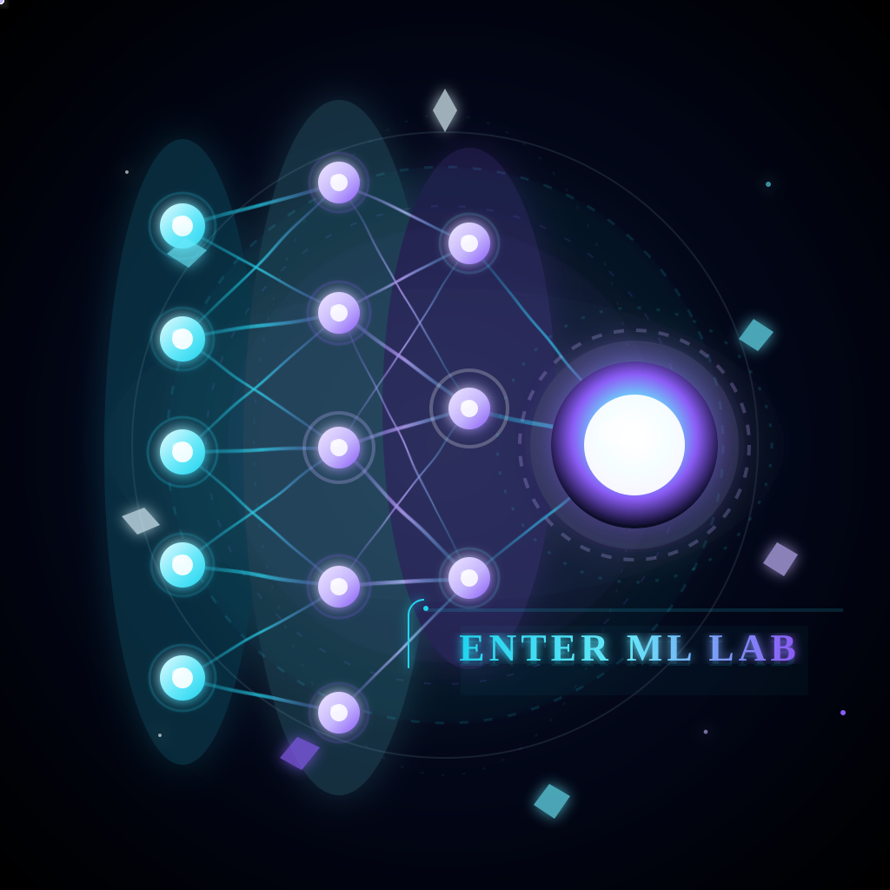

  

  
  
  

  
  
  

---

  <b>The areas I care about most are the ones where a real user, a real device, and a real deadline meet.</b>

  This page maps the technical domains behind my projects and labs: Android apps, web and PWAs, Blogger themes and SEO, motion and graphic design, and small AI experiments.

    

## Core Domains

  

| Domain | What I build there |
| --- | --- |
| Android | Native Kotlin apps, permissions, notifications, local data. |
| Web & PWA | React, Vite, responsive sites, Supabase, Firebase, APIs. |
| Blogger & SEO | Custom themes, custom Bangla fonts, blog design, image hosting. |
| Motion & Graphics | Motion video editing, thumbnails, posters, visual identity. |
| AI Experiments | Chatbots and small AI tools for everyday problems. |
| Tech Tricks | Internet shortcuts, automation, and useful hacks. |

## Labs

  <a href="./LABS.md"><b>Open dedicated Labs page</b></a>

| Lab | Purpose |
| --- | --- |
| Neural Lab | Planned interactive AI visualization and model intuition. |
| Molecule Lab | Planned hands-on building from units, parts, and structures. |
| Model Forge | A planned guided environment for learning technical foundations. |

## Engineering Principles

  

## Related Pages

- [Projects](./PROJECTS.md)
- [Labs](./LABS.md)
- [Collaboration](./COLLAB.md)
- [Main Blog](https://rsf-robiul.blogspot.com/)
