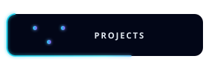

<p align="center">
  
</p>


<p align="center">
  <a href="../../README.md">
    
  </a>
  <a href="./PROJECTS.md">
    
  </a>
  <a href="./AI_DOMAIN.md">
    
  </a>
</p>

<p align="center">
  <a href="https://rsf-robiul.blogspot.com/">
    
  </a>
  <a href="https://rsf-robiul.blogspot.com/">
    
  </a>
  <a href="./COLLAB.md">
    
  </a>
</p>


---

<p align="center">
  
</p>


<p align="center">
  <b>I like collaboration best when there is a real artifact at the end: an app people open, a site people read, or a video people watch.</b>
</p>

<p align="center">
  I work across Android apps, web and PWAs, Blogger themes and SEO, motion video, and graphic design. I care about clear scope, honest timelines, and work that ships.
</p>

<p align="center">
  
</p>

---

## Collaboration Protocol

I like collaborations where the idea can survive contact with implementation. That usually means the project has a concrete problem, a visible technical path, and enough discipline to turn exploration into something usable.

| Signal | What it means |
| --- | --- |
| `BUILD` | There is a real artifact to design, implement, test, or improve. |
| `CONTENT` | There is a story, lesson, or announcement worth telling well. |
| `DESIGN` | The work needs visuals: thumbnails, posters, motion, identity. |
| `LEARNING` | The output helps people understand a difficult concept more clearly. |
| `OPEN SOURCE` | The project benefits from public documentation, clean interfaces, and maintainable structure. |

## High-Value Collaboration Zones

### Android & Mobile

Native Kotlin apps, PWA wrappers, notifications, local data, and small utilities that solve one problem properly.

### Web & PWAs

React and Vite front ends, Supabase and Firebase back ends, landing pages, and fast responsive sites.

### Blogger, Themes & SEO

Custom Blogger themes, custom Bangla fonts, blog design, image hosting, and search visibility.

### Motion Video & Graphics

Motion videos, thumbnails, posters, social creatives, and visual identity for channels and products.

### AI Experiments

Chatbots and small AI tools for everyday problems — useful first, flashy second.

### Tech Tricks & Tools

Internet shortcuts, automation, small developer tools, and the kind of hacks that save an hour every week.

## What Makes A Strong First Message

The best collaboration message is short, specific, and grounded.

```text
Subject: Collaboration idea: <short project name>

I am building / exploring:
<one or two sentences>

The technical problem is:
<what is hard, unclear, or worth solving>

What exists now:
<repo, demo, paper, sketch, notes, or current status>

Where I think you might fit:
<android, web, blogger/theme, motion video, graphics, SEO, review, etc.>

First useful milestone:
<something small enough to actually start>
```

If the first milestone is clear, the conversation can become technical quickly. That is usually a good sign.

## Good Fit / Poor Fit

<p align="center">
  
</p>

## Operating Style

<p align="center">
  
</p>

## Contact Vector

If the work connects to Android, web, Blogger, motion video, graphics, or small AI tools, send the idea through one of the channels in the main [README](../../README.md).

Useful links:

- [Projects](./PROJECTS.md)
- [Domains](./AI_DOMAIN.md)
- [Labs](./LABS.md)
- [Main Blog](https://rsf-robiul.blogspot.com/)
- [GitHub Profile](../../README.md)
