  

  
  
  

  
  
  

---

  

  <b>Neural Lab</b> ·
  <b>Molecule Lab</b> ·
  <b>Model Forge</b>

  The lab doors will open here soon: live interactive demos will be published from this profile on GitHub Pages when they are ready.

## Launch Hub

The labs are the interactive side of this profile: small technical environments for exploring systems directly instead of only reading about them.

| Lab | Status | Value |
| --- | --- | --- |
| Neural Lab | Planned / coming soon | Explore AI behavior through visual interaction and model intuition. |
| Molecule Lab | Planned / coming soon | Build structures from units and parts to make composition easier to inspect. |
| Model Forge | Planned / coming soon | Learn core technical foundations through guided, visual, hands-on concepts. |

## Lab Mission

  

## What Each Lab Should Prove

| Lab | It should help visitors understand |
| --- | --- |
| Neural Lab | How model structure, signals, and learning behavior connect. |
| Molecule Lab | How atoms, bonds, and spatial structures produce molecules. |
| Model Forge | How ML concepts fit together before production implementation. |

## Related Pages

- [AI Domains](./AI_DOMAIN.md)
- [Projects](./PROJECTS.md)
- [Collaboration](./COLLAB.md)
- [Main Blog](https://rsf-robiul.blogspot.com/)
