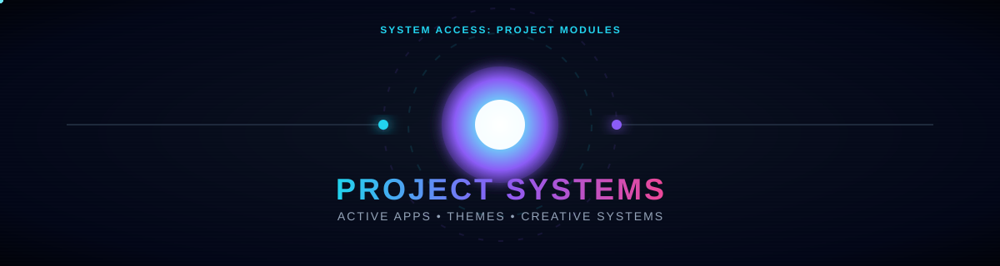
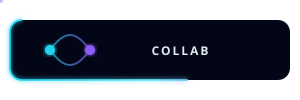
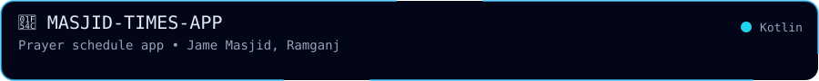
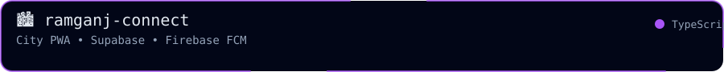
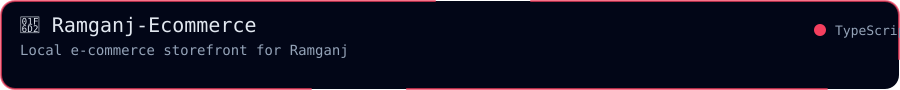
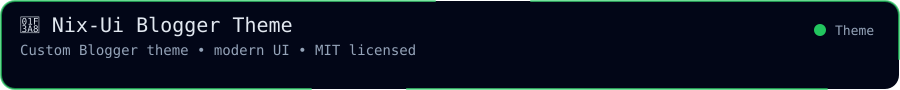
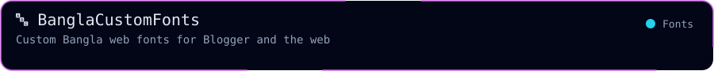
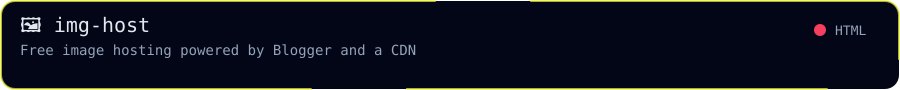

  

  
  
  

  
  
  

---

  <b>Selected work across Android apps, web development, Blogger tooling, and creative media.</b>

  This page highlights the projects that match the direction of my GitHub profile: mobile apps, city-scale web apps, custom Blogger themes, AI chatbot experiments, and the tools I build for everyday use.

<h2 align="center">🧪 Project Highlights</h2>

<!-- Row 1 -->

  
  

<!-- Row 2 -->

  
  

<!-- Row 3 -->

  
  

## Project Index

| Project | Focus | Status | Why it matters |
| --- | --- | --- | --- |
| [MASJID-TIMES-APP](https://github.com/Robiul3100/MASJID-TIMES-APP) | Android, Kotlin | Live | A native prayer-schedule app for a local Jame Masjid, built for daily use. |
| [ramganj-connect](https://github.com/Robiul3100/ramganj-connect) | React PWA, Supabase, Firebase | Live | A city information PWA with push notifications for Ramganj. |
| [Ramganj-Ecommerce](https://github.com/Robiul3100/Ramganj-Ecommerce) | TypeScript, e-commerce | Active | A storefront for local buyers and sellers. |
| [Nix-Ui-Blogger-Theme-](https://github.com/Robiul3100/Nix-Ui-Blogger-Theme-) | Blogger theme, design | MIT | A modern, modified Blogger theme ready to install. |
| [BanglaCustomFonts](https://github.com/Robiul3100/BanglaCustomFonts) | Bangla typography, web fonts | Active | Custom Bangla fonts for Blogger and websites. |
| [img-host](https://github.com/Robiul3100/img-host) | Hosting, CDN | Live | Free image hosting powered by Blogger and a CDN. |
| [Tabassum-Ai](https://github.com/Robiul3100/Tabassum-Ai) | AI chatbot | Experiment | A personal chatbot project exploring conversational AI. |
| [M0Ti0N_R0BiUL](https://github.com/Robiul3100/M0Ti0N_R0BiUL) | Motion, TypeScript | MIT | Motion graphics tooling for video and visual work. |

## Current Direction

  

## What To Look At First

  

---

<h2 align="center">📊 Activity</h2>

  
    

